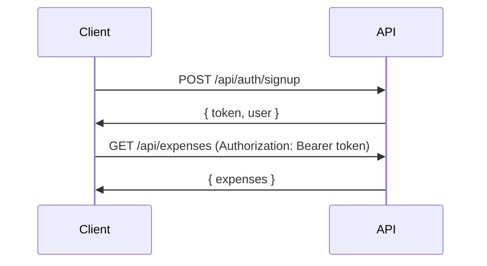

# ThoughtExpense API Documentation

**Version**: 1.0.0  
**Base URL**: `https://api.thoughtexpense.com` (Production) | `http://localhost:7100` (Development)  
**Protocol**: HTTPS (Production) | HTTP (Development)

---

## Table of Contents

1. [Overview](#overview)
2. [Authentication](#authentication)
3. [Error Handling](#error-handling)
4. [Rate Limiting](#rate-limiting)
5. [Endpoints](#endpoints)
   - [Authentication](#authentication-endpoints)
   - [Expenses](#expense-endpoints)
   - [Insights](#insight-endpoints)
6. [Data Models](#data-models)
7. [Response Codes](#response-codes)
8. [Code Examples](#code-examples)
9. [Postman Collection](#postman-collection)
10. [Changelog](#changelog)

---

## Overview

The ThoughtExpense API is a RESTful API that enables natural language expense tracking powered by AI. The API accepts unstructured text input and automatically categorizes expenses using OpenAI's language models and a custom RAG (Retrieval-Augmented Generation) system.

### Key Features

- 🧠 **Natural Language Processing** - Parse expenses from plain text
- 🤖 **AI-Powered Categorization** - Automatic expense classification with confidence scores
- 🔍 **Smart Learning** - RAG system improves accuracy from user corrections
- 📊 **Insights Generation** - Weekly spending analysis and trends
- ⚡ **High Performance** - Redis caching for sub-200ms responses
- 🔒 **Secure** - JWT authentication, encrypted data, rate limiting

### Technology Stack

- **Runtime**: Node.js + TypeScript
- **Framework**: Express.js
- **Database**: PostgreSQL with Prisma ORM
- **Cache**: Redis
- **AI**: OpenAI GPT-3.5-turbo
- **Vector DB**: Pinecone

---

## Authentication

The API uses **JWT (JSON Web Tokens)** for authentication. Include the token in the `Authorization` header for all protected endpoints.

### Authentication Flow



### Header Format

```http
Authorization: Bearer <your_jwt_token>
```

### Token Expiration

- **Default**: 7 days
- **Refresh**: Re-login required after expiration
- **Storage**: Store securely (httpOnly cookies recommended for web apps)

---

## Error Handling

All errors follow a consistent structure:

### Error Response Format

```json
{
  "success": false,
  "message": "Error description",
  "errors": [
    {
      "field": "email",
      "message": "Invalid email format"
    }
  ]
}
```

### Common Error Codes

| Code | Meaning | Description |
|------|---------|-------------|
| `400` | Bad Request | Invalid request data or parameters |
| `401` | Unauthorized | Missing or invalid authentication token |
| `403` | Forbidden | Valid token but insufficient permissions |
| `404` | Not Found | Resource doesn't exist |
| `422` | Unprocessable Entity | Validation failed |
| `429` | Too Many Requests | Rate limit exceeded |
| `500` | Internal Server Error | Server-side error |
| `503` | Service Unavailable | Temporary service disruption |

---

## Rate Limiting

### Limits

- **Rate**: 100 requests per 15 minutes per IP address
- **Scope**: Applied to all `/api/*` endpoints
- **Header**: `X-RateLimit-Remaining` shows remaining requests

### Rate Limit Response

```json
{
  "success": false,
  "message": "Too many requests from this IP, please try again later."
}
```

### Best Practices

- Cache responses when possible
- Implement exponential backoff for retries
- Monitor `X-RateLimit-Remaining` header
- Contact support for higher limits (enterprise)

---

## Endpoints

### Base URL Structure

```
[BASE_URL]/api/[resource]/[action]
```

### Available Resources

- `/api/auth` - Authentication
- `/api/expenses` - Expense management
- `/api/insights` - AI-generated insights

---

## Authentication Endpoints

### 1. Sign Up

Create a new user account.

**Endpoint**: `POST /api/auth/signup`  
**Authentication**: None required

#### Request Body

```json
{
  "email": "user@example.com",
  "password": "securePassword123",
  "name": "John Doe",
  "currency": "USD"
}
```

#### Parameters

| Field | Type | Required | Description |
|-------|------|----------|-------------|
| `email` | string | ✅ Yes | Valid email address |
| `password` | string | ✅ Yes | Minimum 6 characters |
| `name` | string | ⬜ No | User's full name |
| `currency` | string | ⬜ No | 3-letter currency code (default: USD) |

#### Success Response (201 Created)

```json
{
  "success": true,
  "message": "User registered successfully",
  "data": {
    "user": {
      "id": "uuid-v4",
      "email": "user@example.com",
      "name": "John Doe",
      "currency": "USD",
      "createdAt": "2024-01-15T10:30:00.000Z"
    },
    "token": "eyJhbGciOiJIUzI1NiIsInR5cCI6IkpXVCJ9..."
  }
}
```

#### Error Responses

**400 Bad Request** - User already exists
```json
{
  "success": false,
  "message": "User already exists with this email"
}
```

**422 Unprocessable Entity** - Validation error
```json
{
  "success": false,
  "message": "Validation failed",
  "errors": [
    {
      "field": "password",
      "message": "Password must be at least 6 characters"
    }
  ]
}
```

#### cURL Example

```bash
curl -X POST http://localhost:7100/api/auth/signup \
  -H "Content-Type: application/json" \
  -d '{
    "email": "user@example.com",
    "password": "securePassword123",
    "name": "John Doe",
    "currency": "USD"
  }'
```

---

### 2. Login

Authenticate an existing user.

**Endpoint**: `POST /api/auth/login`  
**Authentication**: None required

#### Request Body

```json
{
  "email": "user@example.com",
  "password": "securePassword123"
}
```

#### Parameters

| Field | Type | Required | Description |
|-------|------|----------|-------------|
| `email` | string | ✅ Yes | User's email address |
| `password` | string | ✅ Yes | User's password |

#### Success Response (200 OK)

```json
{
  "success": true,
  "message": "Login successful",
  "data": {
    "user": {
      "id": "uuid-v4",
      "email": "user@example.com",
      "name": "John Doe",
      "currency": "USD",
      "createdAt": "2024-01-15T10:30:00.000Z"
    },
    "token": "eyJhbGciOiJIUzI1NiIsInR5cCI6IkpXVCJ9..."
  }
}
```

#### Error Response (401 Unauthorized)

```json
{
  "success": false,
  "message": "Invalid email or password"
}
```

#### cURL Example

```bash
curl -X POST http://localhost:7100/api/auth/login \
  -H "Content-Type: application/json" \
  -d '{
    "email": "user@example.com",
    "password": "securePassword123"
  }'
```

---

### 3. Get Current User

Retrieve authenticated user's profile.

**Endpoint**: `GET /api/auth/me`  
**Authentication**: ✅ Required

#### Headers

```http
Authorization: Bearer <your_jwt_token>
```

#### Success Response (200 OK)

```json
{
  "success": true,
  "data": {
    "user": {
      "id": "uuid-v4",
      "email": "user@example.com",
      "name": "John Doe",
      "currency": "USD",
      "createdAt": "2024-01-15T10:30:00.000Z"
    }
  }
}
```

#### Error Response (401 Unauthorized)

```json
{
  "success": false,
  "message": "Not authorized to access this route"
}
```

#### cURL Example

```bash
curl -X GET http://localhost:7100/api/auth/me \
  -H "Authorization: Bearer YOUR_JWT_TOKEN"
```

---

## Expense Endpoints

### 1. Parse Expenses (Natural Language)

Parse natural language text into structured expense records using AI.

**Endpoint**: `POST /api/expenses/parse`  
**Authentication**: ✅ Required

#### Request Body

```json
{
  "rawInput": "rent 1200\ncoffee 5\nuber to work 15\ngroceries 85\nnetflix 12"
}
```

#### Parameters

| Field | Type | Required | Description |
|-------|------|----------|-------------|
| `rawInput` | string | ✅ Yes | Natural language expense input (max 5000 chars) |

#### Input Format Examples

```
# Simple format
rent 1000
food 50
taxi 15

# Detailed format
bought coffee for 5 dollars
paid rent $1200
uber ride to airport was 45

# Mixed format
gym membership - $50/month
lunch at McDonald's 12
electricity bill: 80 euros
```

#### Success Response (201 Created)

```json
{
  "success": true,
  "message": "Successfully parsed 5 expense(s)",
  "data": {
    "expenses": [
      {
        "id": "uuid-1",
        "userId": "user-uuid",
        "description": "rent",
        "amount": 1200,
        "currency": "USD",
        "category": "Rent",
        "confidence": 0.95,
        "rawInput": "rent 1200",
        "date": "2024-01-15T10:30:00.000Z",
        "createdAt": "2024-01-15T10:30:00.000Z",
        "updatedAt": "2024-01-15T10:30:00.000Z"
      },
      {
        "id": "uuid-2",
        "userId": "user-uuid",
        "description": "coffee",
        "amount": 5,
        "currency": "USD",
        "category": "Food",
        "confidence": 0.88,
        "rawInput": "coffee 5",
        "date": "2024-01-15T10:30:00.000Z",
        "createdAt": "2024-01-15T10:30:00.000Z",
        "updatedAt": "2024-01-15T10:30:00.000Z"
      }
    ],
    "needsReview": ["uuid-3"]
  }
}
```

#### Response Fields

| Field | Type | Description |
|-------|------|-------------|
| `expenses` | array | Array of parsed expense objects |
| `needsReview` | array | IDs of expenses with confidence < 0.7 |

#### Expense Categories

- **Food** - Groceries, restaurants, dining
- **Transport** - Uber, taxi, gas, parking
- **Rent** - Housing, rent payments
- **Utilities** - Electricity, water, internet, phone
- **Shopping** - Clothes, electronics, general shopping
- **Entertainment** - Movies, games, subscriptions
- **Healthcare** - Doctor, medicine, hospital
- **Education** - Courses, books, tuition
- **Personal Care** - Makeup, salon, grooming
- **Fees** - Bank fees, service charges
- **Other** - Miscellaneous expenses

#### Confidence Scores

| Range | Meaning | Action |
|-------|---------|--------|
| `0.9 - 1.0` | Very High | Auto-categorized correctly |
| `0.7 - 0.9` | High | Likely correct |
| `0.5 - 0.7` | Medium | Review recommended |
| `0.0 - 0.5` | Low | Manual review required |

#### Error Response (400 Bad Request)

```json
{
  "success": false,
  "message": "Could not parse any expenses from input"
}
```

#### cURL Example

```bash
curl -X POST http://localhost:7100/api/expenses/parse \
  -H "Content-Type: application/json" \
  -H "Authorization: Bearer YOUR_JWT_TOKEN" \
  -d '{
    "rawInput": "coffee 5\nrent 1200\nuber 15"
  }'
```

---

### 2. Get Expenses

Retrieve user's expenses with optional filters.

**Endpoint**: `GET /api/expenses`  
**Authentication**: ✅ Required

#### Query Parameters

| Parameter | Type | Required | Description |
|-----------|------|----------|-------------|
| `startDate` | string (ISO 8601) | ⬜ No | Filter expenses from this date |
| `endDate` | string (ISO 8601) | ⬜ No | Filter expenses until this date |
| `category` | string | ⬜ No | Filter by category |
| `limit` | integer | ⬜ No | Number of results (1-100, default: 50) |
| `offset` | integer | ⬜ No | Pagination offset (default: 0) |

#### Success Response (200 OK)

```json
{
  "success": true,
  "data": {
    "expenses": [
      {
        "id": "uuid-1",
        "userId": "user-uuid",
        "description": "rent",
        "amount": 1200,
        "currency": "USD",
        "category": "Rent",
        "confidence": 0.95,
        "rawInput": "rent 1200",
        "date": "2024-01-15T10:30:00.000Z",
        "createdAt": "2024-01-15T10:30:00.000Z",
        "updatedAt": "2024-01-15T10:30:00.000Z"
      }
    ],
    "pagination": {
      "total": 150,
      "limit": 50,
      "offset": 0,
      "hasMore": true
    }
  },
  "cached": false
}
```

#### cURL Example

```bash
# Get all expenses
curl -X GET "http://localhost:7100/api/expenses" \
  -H "Authorization: Bearer YOUR_JWT_TOKEN"

# With filters
curl -X GET "http://localhost:7100/api/expenses?startDate=2024-01-01&category=Food&limit=20" \
  -H "Authorization: Bearer YOUR_JWT_TOKEN"
```

---

### 3. Get Expense by ID

Retrieve a single expense by its ID.

**Endpoint**: `GET /api/expenses/:id`  
**Authentication**: ✅ Required

#### Path Parameters

| Parameter | Type | Required | Description |
|-----------|------|----------|-------------|
| `id` | UUID | ✅ Yes | Expense ID |

#### Success Response (200 OK)

```json
{
  "success": true,
  "data": {
    "expense": {
      "id": "uuid-1",
      "userId": "user-uuid",
      "description": "coffee",
      "amount": 5,
      "currency": "USD",
      "category": "Food",
      "confidence": 0.88,
      "rawInput": "coffee 5",
      "date": "2024-01-15T10:30:00.000Z",
      "createdAt": "2024-01-15T10:30:00.000Z",
      "updatedAt": "2024-01-15T10:30:00.000Z"
    }
  }
}
```

#### Error Response (404 Not Found)

```json
{
  "success": false,
  "message": "Expense not found"
}
```

#### cURL Example

```bash
curl -X GET "http://localhost:7100/api/expenses/uuid-123" \
  -H "Authorization: Bearer YOUR_JWT_TOKEN"
```

---

### 4. Update Expense

Update an existing expense.

**Endpoint**: `PATCH /api/expenses/:id`  
**Authentication**: ✅ Required

#### Path Parameters

| Parameter | Type | Required | Description |
|-----------|------|----------|-------------|
| `id` | UUID | ✅ Yes | Expense ID |

#### Request Body

```json
{
  "description": "morning coffee",
  "amount": 6.50,
  "category": "Food",
  "date": "2024-01-15T08:00:00.000Z"
}
```

#### Updateable Fields

| Field | Type | Description |
|-------|------|-------------|
| `description` | string | Expense description |
| `amount` | number | Expense amount (positive) |
| `currency` | string | 3-letter currency code |
| `category` | string | Expense category |
| `date` | string (ISO 8601) | Expense date |

#### Success Response (200 OK)

```json
{
  "success": true,
  "message": "Expense updated successfully",
  "data": {
    "expense": {
      "id": "uuid-1",
      "userId": "user-uuid",
      "description": "morning coffee",
      "amount": 6.50,
      "currency": "USD",
      "category": "Food",
      "confidence": 1.0,
      "rawInput": "coffee 5",
      "date": "2024-01-15T08:00:00.000Z",
      "createdAt": "2024-01-15T10:30:00.000Z",
      "updatedAt": "2024-01-15T11:00:00.000Z"
    }
  }
}
```

#### Note on Category Updates

When you update an expense's category, the system learns from this correction:
- Confidence score is set to `1.0`
- The correction is stored in the RAG system
- Future similar expenses will benefit from this learning

#### cURL Example

```bash
curl -X PATCH "http://localhost:7100/api/expenses/uuid-123" \
  -H "Content-Type: application/json" \
  -H "Authorization: Bearer YOUR_JWT_TOKEN" \
  -d '{
    "category": "Food",
    "amount": 6.50
  }'
```

---

### 5. Delete Expense

Delete an expense.

**Endpoint**: `DELETE /api/expenses/:id`  
**Authentication**: ✅ Required

#### Path Parameters

| Parameter | Type | Required | Description |
|-----------|------|----------|-------------|
| `id` | UUID | ✅ Yes | Expense ID |

#### Success Response (200 OK)

```json
{
  "success": true,
  "message": "Expense deleted successfully"
}
```

#### Error Response (404 Not Found)

```json
{
  "success": false,
  "message": "Expense not found"
}
```

#### cURL Example

```bash
curl -X DELETE "http://localhost:7100/api/expenses/uuid-123" \
  -H "Authorization: Bearer YOUR_JWT_TOKEN"
```

---

### 6. Get Category Summary

Get aggregated spending by category.

**Endpoint**: `GET /api/expenses/summary`  
**Authentication**: ✅ Required

#### Query Parameters

| Parameter | Type | Required | Description |
|-----------|------|----------|-------------|
| `startDate` | string (ISO 8601) | ⬜ No | Summary from this date |
| `endDate` | string (ISO 8601) | ⬜ No | Summary until this date |

#### Success Response (200 OK)

```json
{
  "success": true,
  "data": {
    "totalSpent": 1517.50,
    "currency": "USD",
    "byCategory": {
      "Rent": 1200,
      "Food": 215.50,
      "Transport": 87,
      "Entertainment": 15
    },
    "percentages": {
      "Rent": "79.09",
      "Food": "14.20",
      "Transport": "5.73",
      "Entertainment": "0.99"
    },
    "topCategories": ["Rent", "Food", "Transport"],
    "transactionCount": 47
  },
  "cached": false
}
```

#### Response Fields

| Field | Type | Description |
|-------|------|-------------|
| `totalSpent` | number | Total amount spent |
| `currency` | string | User's currency |
| `byCategory` | object | Amount spent per category |
| `percentages` | object | Percentage of total per category |
| `topCategories` | array | Top 3 spending categories |
| `transactionCount` | number | Number of transactions |

#### cURL Example

```bash
# All time
curl -X GET "http://localhost:7100/api/expenses/summary" \
  -H "Authorization: Bearer YOUR_JWT_TOKEN"

# Date range
curl -X GET "http://localhost:7100/api/expenses/summary?startDate=2024-01-01&endDate=2024-01-31" \
  -H "Authorization: Bearer YOUR_JWT_TOKEN"
```

---

### 7. Get Similar Expenses (RAG)

Find similar expenses using AI-powered similarity search.

**Endpoint**: `GET /api/expenses/:id/similar`  
**Authentication**: ✅ Required

#### Path Parameters

| Parameter | Type | Required | Description |
|-----------|------|----------|-------------|
| `id` | UUID | ✅ Yes | Expense ID |

#### Success Response (200 OK)

```json
{
  "success": true,
  "data": {
    "similar": [
      {
        "id": "uuid-2",
        "description": "starbucks coffee",
        "amount": 5.75,
        "currency": "USD",
        "category": "Food",
        "date": "2024-01-10T09:15:00.000Z",
        "similarity": 0.92
      },
      {
        "id": "uuid-3",
        "description": "morning coffee",
        "amount": 4.50,
        "currency": "USD",
        "category": "Food",
        "date": "2024-01-08T08:30:00.000Z",
        "similarity": 0.87
      }
    ]
  }
}
```

#### Use Cases

- Find duplicate expenses
- Discover spending patterns
- Analyze similar transactions
- Budget planning

#### cURL Example

```bash
curl -X GET "http://localhost:7100/api/expenses/uuid-123/similar" \
  -H "Authorization: Bearer YOUR_JWT_TOKEN"
```

---

## Insight Endpoints

### 1. Generate Weekly Insights

Generate AI-powered spending insights for the past week.

**Endpoint**: `POST /api/insights/generate`  
**Authentication**: ✅ Required

#### Request Body

None required

#### Success Response (200 OK)

```json
{
  "success": true,
  "message": "Insights generated successfully",
  "data": {
    "insights": [
      {
        "id": "insight-uuid-1",
        "userId": "user-uuid",
        "type": "weekly",
        "content": "Food spending increased 18% compared to last week.",
        "metadata": {
          "summary": {
            "totalSpent": 450.75,
            "currency": "USD",
            "byCategory": {
              "Food": 215.50,
              "Transport": 87,
              "Entertainment": 15
            },
            "percentages": {
              "Food": "47.81",
              "Transport": "19.30",
              "Entertainment": "3.33"
            },
            "topCategories": ["Food", "Transport", "Entertainment"]
          },
          "expenseCount": 23,
          "period": {
            "start": "2024-01-08T00:00:00.000Z",
            "end": "2024-01-15T00:00:00.000Z"
          }
        },
        "period": "2024-01-15T00:00:00.000Z",
        "createdAt": "2024-01-15T10:30:00.000Z"
      },
      {
        "id": "insight-uuid-2",
        "userId": "user-uuid",
        "type": "weekly",
        "content": "Transport costs appear frequently but amounts are small.",
        "metadata": {},
        "period": "2024-01-15T00:00:00.000Z",
        "createdAt": "2024-01-15T10:30:00.000Z"
      }
    ],
    "summary": {
      "totalSpent": 450.75,
      "currency": "USD",
      "byCategory": {
        "Food": 215.50,
        "Transport": 87,
        "Entertainment": 15
      },
      "percentages": {
        "Food": "47.81",
        "Transport": "19.30",
        "Entertainment": "3.33"
      },
      "topCategories": ["Food", "Transport", "Entertainment"]
    }
  }
}
```

#### Response When No Data

```json
{
  "success": true,
  "message": "No expenses to analyze",
  "data": {
    "insights": []
  }
}
```

#### Insight Characteristics

- **Non-Judgmental**: Informational, not prescriptive
- **Actionable**: Focus on patterns and trends
- **Concise**: Maximum 2-3 sentences per insight
- **Data-Driven**: Based on actual spending patterns
- **Comparative**: Compares with previous periods when possible

#### cURL Example

```bash
curl -X POST "http://localhost:7100/api/insights/generate" \
  -H "Authorization: Bearer YOUR_JWT_TOKEN"
```

---

### 2. Get Insights

Retrieve previously generated insights.

**Endpoint**: `GET /api/insights`  
**Authentication**: ✅ Required

#### Query Parameters

| Parameter | Type | Required | Description |
|-----------|------|----------|-------------|
| `type` | string | ⬜ No | Filter by type: 'weekly', 'monthly', 'trend' |
| `limit` | integer | ⬜ No | Number of results (1-50, default: 10) |

#### Success Response (200 OK)

```json
{
  "success": true,
  "data": {
    "insights": [
      {
        "id": "insight-uuid-1",
        "userId": "user-uuid",
        "type": "weekly",
        "content": "Food spending increased 18% compared to last week.",
        "metadata": {},
        "period": "2024-01-15T00:00:00.000Z",
        "createdAt": "2024-01-15T10:30:00.000Z"
      }
    ]
  },
  "cached": false
}
```

#### cURL Example

```bash
# Get all insights
curl -X GET "http://localhost:7100/api/insights" \
  -H "Authorization: Bearer YOUR_JWT_TOKEN"

# Filter by type
curl -X GET "http://localhost:7100/api/insights?type=weekly&limit=5" \
  -H "Authorization: Bearer YOUR_JWT_TOKEN"
```

---

## Data Models

### User

```typescript
{
  id: string;           // UUID v4
  email: string;        // Unique, validated
  name: string | null;  // Optional
  currency: string;     // 3-letter code (ISO 4217)
  createdAt: Date;      // Account creation timestamp
}
```

### Expense

```typescript
{
  id: string;           // UUID v4
  userId: string;       // Foreign key to User
  description: string;  // Expense description
  amount: number;       // Positive decimal
  currency: string;     // 3-letter code (ISO 4217)
  category: string;     // Predefined category
  confidence: number;   // 0.0 - 1.0
  rawInput: string;     // Original input text
  date: Date;           // Expense date
  createdAt: Date;      // Record creation timestamp
  updatedAt: Date;      // Last update timestamp
}
```

### Insight

```typescript
{
  id: string;           // UUID v4
  userId: string;       // Foreign key to User
  type: string;         // 'weekly', 'monthly', 'trend'
  content: string;      // Insight text
  metadata: object;     // Structured data (summary, period, etc.)
  period: Date;         // Period this insight covers
  createdAt: Date;      // Creation timestamp
}
```

---

## Response Codes

### Success Codes

| Code | Meaning | Usage |
|------|---------|-------|
| `200` | OK | Successful GET, PATCH, DELETE |
| `201` | Created | Successful POST (resource created) |

### Error Codes

| Code | Meaning | Description |
|------|---------|-------------|
| `400` | Bad Request | Invalid request data or parameters |
| `401` | Unauthorized | Missing or invalid authentication token |
| `403` | Forbidden | Valid token but insufficient permissions |
| `404` | Not Found | Resource doesn't exist |
| `422` | Unprocessable Entity | Validation failed |
| `429` | Too Many Requests | Rate limit exceeded |
| `500` | Internal Server Error | Server-side error |
| `503` | Service Unavailable | Temporary service disruption |

---

## Code Examples

### JavaScript (Fetch API)

```javascript
// Signup
const signup = async () => {
  const response = await fetch('http://localhost:7100/api/auth/signup', {
    method: 'POST',
    headers: { 'Content-Type': 'application/json' },
    body: JSON.stringify({
      email: 'user@example.com',
      password: 'password123',
      name: 'John Doe'
    })
  });
  const data = await response.json();
  localStorage.setItem('token', data.data.token);
  return data;
};

// Parse Expenses
const parseExpenses = async (rawInput) => {
  const token = localStorage.getItem('token');
  const response = await fetch('http://localhost:7100/api/expenses/parse', {
    method: 'POST',
    headers: {
      'Content-Type': 'application/json',
      'Authorization': `Bearer ${token}`
    },
    body: JSON.stringify({ rawInput })
  });
  return await response.json();
};

// Get Expenses
const getExpenses = async (filters = {}) => {
  const token = localStorage.getItem('token');
  const params = new URLSearchParams(filters);
  const response = await fetch(`http://localhost:7100/api/expenses?${params}`, {
    headers: { 'Authorization': `Bearer ${token}` }
  });
  return await response.json();
};
```

### Python (Requests)

```python
import requests

BASE_URL = "http://localhost:7100"

# Signup
def signup(email, password, name=None):
    response = requests.post(
        f"{BASE_URL}/api/auth/signup",
        json={
            "email": email,
            "password": password,
            "name": name
        }
    )
    data = response.json()
    return data['data']['token']

# Parse Expenses
def parse_expenses(token, raw_input):
    response = requests.post(
        f"{BASE_URL}/api/expenses/parse",
        headers={"Authorization": f"Bearer {token}"},
        json={"rawInput": raw_input}
    )
    return response.json()

# Get Expenses
def get_expenses(token, **filters):
    response = requests.get(
        f"{BASE_URL}/api/expenses",
        headers={"Authorization": f"Bearer {token}"},
        params=filters
    )
    return response.json()

# Example usage
token = signup("user@example.com", "password123", "John Doe")
result = parse_expenses(token, "coffee 5\nrent 1200")
expenses = get_expenses(token, category="Food", limit=20)
```

### Node.js (Axios)

```javascript
const axios = require('axios');

const BASE_URL = 'http://localhost:7100';
let token = null;

// Signup
const signup = async (email, password, name) => {
  const { data } = await axios.post(`${BASE_URL}/api/auth/signup`, {
    email, password, name
  });
  token = data.data.token;
  return data;
};

// Parse Expenses
const parseExpenses = async (rawInput) => {
  const { data } = await axios.post(
    `${BASE_URL}/api/expenses/parse`,
    { rawInput },
    { headers: { Authorization: `Bearer ${token}` } }
  );
  return data;
};

// Get Category Summary
const getSummary = async (startDate, endDate) => {
  const { data } = await axios.get(`${BASE_URL}/api/expenses/summary`, {
    params: { startDate, endDate },
    headers: { Authorization: `Bearer ${token}` }
  });
  return data;
};

// Generate Insights
const generateInsights = async () => {
  const { data } = await axios.post(
    `${BASE_URL}/api/insights/generate`,
    {},
    { headers: { Authorization: `Bearer ${token}` } }
  );
  return data;
};
```

### cURL

```bash
# Set token variable
TOKEN="your_jwt_token_here"

# Signup
curl -X POST http://localhost:7100/api/auth/signup \
  -H "Content-Type: application/json" \
  -d '{"email":"user@example.com","password":"pass123","name":"John"}'

# Login
curl -X POST http://localhost:7100/api/auth/login \
  -H "Content-Type: application/json" \
  -d '{"email":"user@example.com","password":"pass123"}'

# Parse Expenses
curl -X POST http://localhost:7100/api/expenses/parse \
  -H "Content-Type: application/json" \
  -H "Authorization: Bearer $TOKEN" \
  -d '{"rawInput":"coffee 5\nrent 1200"}'

# Get Expenses with Filters
curl -G http://localhost:7100/api/expenses \
  -H "Authorization: Bearer $TOKEN" \
  --data-urlencode "category=Food" \
  --data-urlencode "limit=20"

# Get Summary
curl -X GET http://localhost:7100/api/expenses/summary \
  -H "Authorization: Bearer $TOKEN"

# Generate Insights
curl -X POST http://localhost:7100/api/insights/generate \
  -H "Authorization: Bearer $TOKEN"
```

---

## Postman Collection

Import this collection into Postman for easy API testing.

### Collection JSON

```json
{
  "info": {
    "name": "ThoughtExpense API",
    "description": "Natural language expense tracker API",
    "schema": "https://schema.getpostman.com/json/collection/v2.1.0/collection.json"
  },
  "auth": {
    "type": "bearer",
    "bearer": [
      {
        "key": "token",
        "value": "{{jwt_token}}",
        "type": "string"
      }
    ]
  },
  "variable": [
    {
      "key": "base_url",
      "value": "http://localhost:7100",
      "type": "string"
    },
    {
      "key": "jwt_token",
      "value": "",
      "type": "string"
    }
  ],
  "item": [
    {
      "name": "Authentication",
      "item": [
        {
          "name": "Signup",
          "request": {
            "method": "POST",
            "header": [],
            "body": {
              "mode": "raw",
              "raw": "{\n  \"email\": \"user@example.com\",\n  \"password\": \"password123\",\n  \"name\": \"John Doe\"\n}",
              "options": {
                "raw": {
                  "language": "json"
                }
              }
            },
            "url": "{{base_url}}/api/auth/signup"
          }
        },
        {
          "name": "Login",
          "request": {
            "method": "POST",
            "header": [],
            "body": {
              "mode": "raw",
              "raw": "{\n  \"email\": \"user@example.com\",\n  \"password\": \"password123\"\n}",
              "options": {
                "raw": {
                  "language": "json"
                }
              }
            },
            "url": "{{base_url}}/api/auth/login"
          }
        },
        {
          "name": "Get Current User",
          "request": {
            "method": "GET",
            "header": [],
            "url": "{{base_url}}/api/auth/me"
          }
        }
      ]
    },
    {
      "name": "Expenses",
      "item": [
        {
          "name": "Parse Expenses",
          "request": {
            "method": "POST",
            "header": [],
            "body": {
              "mode": "raw",
              "raw": "{\n  \"rawInput\": \"coffee 5\\nrent 1200\\nuber 15\"\n}",
              "options": {
                "raw": {
                  "language": "json"
                }
              }
            },
            "url": "{{base_url}}/api/expenses/parse"
          }
        },
        {
          "name": "Get Expenses",
          "request": {
            "method": "GET",
            "header": [],
            "url": {
              "raw": "{{base_url}}/api/expenses?limit=20",
              "host": ["{{base_url}}"],
              "path": ["api", "expenses"],
              "query": [
                {
                  "key": "limit",
                  "value": "20"
                }
              ]
            }
          }
        },
        {
          "name": "Get Category Summary",
          "request": {
            "method": "GET",
            "header": [],
            "url": "{{base_url}}/api/expenses/summary"
          }
        }
      ]
    },
    {
      "name": "Insights",
      "item": [
        {
          "name": "Generate Insights",
          "request": {
            "method": "POST",
            "header": [],
            "url": "{{base_url}}/api/insights/generate"
          }
        },
        {
          "name": "Get Insights",
          "request": {
            "method": "GET",
            "header": [],
            "url": "{{base_url}}/api/insights"
          }
        }
      ]
    }
  ]
}
```

### Quick Start with Postman

1. **Import Collection**: Copy JSON above → Postman → Import
2. **Set Base URL**: Edit collection → Variables → Set `base_url`
3. **Signup/Login**: Run signup request
4. **Copy Token**: From response, copy the `token` value
5. **Set Token**: Collection → Authorization → Paste token
6. **Test Endpoints**: All requests now authenticated

---

## Changelog

### Version 1.0.0 (2024-01-15)

**Initial Release**

- ✅ User authentication (signup, login)
- ✅ Natural language expense parsing
- ✅ Expense CRUD operations
- ✅ Category-based expense summarization
- ✅ RAG-powered similar expense search
- ✅ AI-generated weekly insights
- ✅ Redis caching for performance
- ✅ Rate limiting for API protection

---

## Support

### Getting Help

- **Documentation**: This document
- **GitHub Issues**: [github.com/yourorg/thoughtexpense/issues](https://github.com)
- **Email**: support@thoughtexpense.com
- **Discord**: [discord.gg/thoughtexpense](https://discord.gg)

### Reporting Bugs

Include:
1. API endpoint
2. Request payload
3. Expected vs actual response
4. Timestamp
5. Environment (dev/production)

### Feature Requests

Submit via GitHub Issues with label `enhancement`.

---

## License

MIT License - See LICENSE file for details.

---

**Last Updated**: February 10, 2026  
**API Version**: 1.0.0  
**Documentation Version**: 1.0.0
